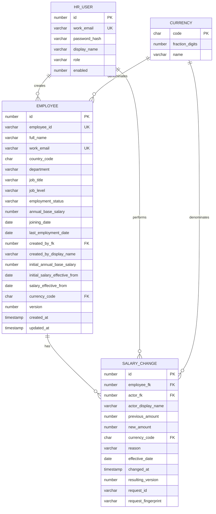
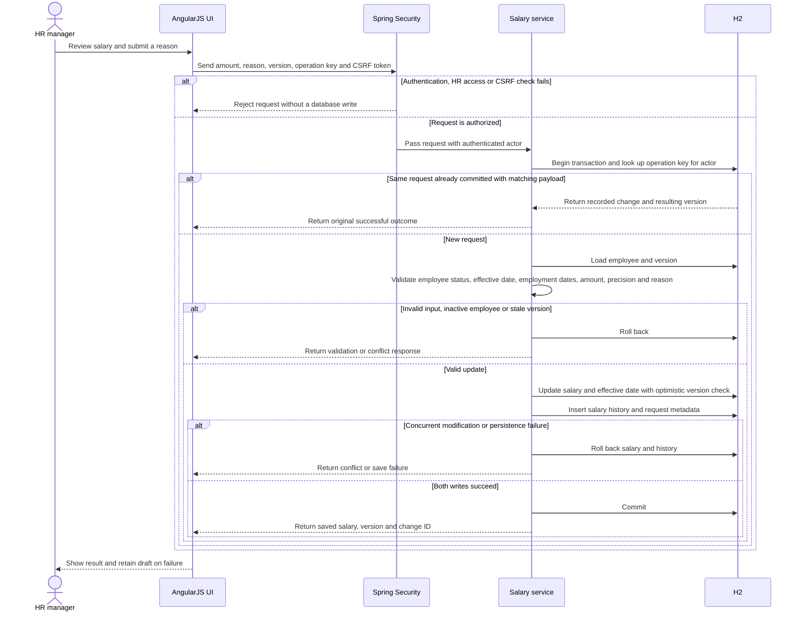

# ACME Salary Management — Technical Design

This design defines the implementation of the [agreed requirements](requirements.md) and [business rules](requirements-rules.md). It covers one organization, one HR permission level, annual base salaries, monthly estimates, and the eight [Figma screens](design/figma-ui.md).

## 1. Architecture and boundaries

Use a modular monolith: one Spring Boot application with an AngularJS frontend and an H2 relational database. Deploy frontend assets and API under the same origin. This keeps session authentication and deployment straightforward for the assessment while preserving clear internal module boundaries.

```mermaid
flowchart LR
    hr["HR manager's browser"]
    subgraph app["Application deployment boundary"]
        ui["AngularJS UI and static assets"]
        security["Spring Security: session, HR access, CSRF"]
        api["Spring Web: controllers and DTO validation"]
        services["Employee, salary and reporting services"]
        data["JPA repositories and H2 reporting queries"]
        ui -->|"Same-origin API requests"| security
        security --> api
        api --> services
        services --> data
    end
    subgraph database["Private database boundary"]
        database[("H2")]
    end
    hr -->|"HTTPS"| ui
    data -->|"JDBC"| oracle
    migration["Versioned Liquibase migrations"] --> database
    seed["First-run Datafaker seed changeset"] --> database
```

The browser never connects directly to H2. Backend access checks are authoritative.

| Area | Decision |
|---|---|
| Runtime and build | JDK 21 and Maven Wrapper |
| Backend | Spring Boot, Spring Web, Spring Data JPA, Spring Security, Bean Validation |
| Frontend | AngularJS, with a compatible component library and locally built assets |
| Database | H2; persistent H2 for local development |
| Migrations | Liquibase YAML changelogs; Hibernate validates the resulting schema |
| Authentication | Pre-provisioned named HR accounts and server-side sessions |
| Tests | Unit tests, Spring integration tests against H2, and Playwright workflows |

Pin the Spring Boot, JDBC driver, Liquibase, frontend packages, and component library versions during project bootstrap and record them in build/lock files. Use compatible stable releases rather than independently selecting the newest version of each dependency. Select the component library and exact release versions during bootstrap.

AngularJS is the assignment-driven frontend choice and must not be silently replaced with modern Angular. Its support status and rationale are recorded in the [engineering decision log](engineering-notes.md). The Java backend remains independent of the frontend framework.

## 2. Application structure

Organize the backend by feature, with controller, service, DTO, and persistence responsibilities inside each feature:

```text
backend/
  src/main/java/.../salarymanagement/
    security/       HR identity, authentication, authorization
    employee/       Directory, profiles, creation, detail edits, inactive status
    salary/         Salary updates and read-only change history
    reporting/      Filtered aggregates and grouping
    reference/      Supported currencies, countries, departments, job levels
    common/         Error responses and shared infrastructure
  src/main/resources/db/changelog/
frontend/
  src/              AngularJS routes, components, API services and styles
tests/              Playwright application workflows
docs/               Requirements, design and delivery evidence
```

Controllers translate HTTP requests and responses. Services own business decisions and transaction boundaries. Repositories own database access. Return DTOs rather than exposing JPA entities or password hashes. Share currency validation and filter interpretation across employee creation, salary updates, reports, and seeding.

Use constructor injection and focused responsibilities. Keep pure validation and decimal calculations independent of Spring startup and database access. Apply SOLID principles where they improve cohesion and substitutability; do not add an interface for every class or a generic framework for one use case. Refactor demonstrated duplication, keep dependencies explicit, and prefer the smallest design that satisfies tested behavior.

Develop core business behavior and bug fixes with red–green–refactor. The [testing strategy](testing-strategy.md) defines test boundaries, acceptance examples, and the evidence required to claim TDD or passing behavior.

## 3. Data model

Keep the current salary on the employee record. A separate current-salary table would add a one-to-one join without supporting an additional initial-release use case. Salary history stores immutable snapshots of changes.



Logical types above are illustrative; migrations define exact H2 types, lengths, precision, and indexes.

- Use an internal numeric primary key separately from the visible, immutable employee ID.
- Trim employee IDs and emails. Enforce work-email uniqueness using a persisted normalized value with a unique constraint; application checks alone are insufficient. Uniqueness includes inactive employees.
- Store current and historical salary amounts as H2 `DECIMAL(19,4)` and map them to Java `BigDecimal`. The [employee API contract](api-employees.md) defines input range and currency-specific fractional validation; the initial migration must enforce compatible storage limits. Do not use floating point for money.
- Require positive, non-null current and historical amounts. Validate supported currency, country, department, and job-level values against the configured reference data. Currency precision comes from `CURRENCY`.
- Restrict employment status to `ACTIVE` or `INACTIVE`. Preserve employee records. Initial creation sets active status.
- Map `version` to JPA optimistic locking. Detail edits, salary updates, and inactive-status updates all participate in version checks on the same employee.
- Generate audit timestamps on the server, store unambiguous instants with an appropriate H2 timestamp type, and return ISO-8601 timestamps with an offset. Display the timezone explicitly.
- Store the actor's stable HR user ID and display-name snapshot at change time, preserving immutable history/replay after a rename. HR accounts are disabled rather than deleted when referenced by history.
- Preserve immutable salary history. Employee creation stores the immutable initial amount/effective date and creation actor snapshot alongside the current salary; history entries record subsequent changes and their effective dates.
- Enforce a unique `(actor_fk, request_id)` key on successful salary-change requests. Here `request_id` stores the client operation's `Idempotency-Key`, not the HTTP tracing ID. Persist the fingerprint, original change fields, actor snapshot and resulting version for the lifetime of retained history.

Store employment and salary dates as H2 `DATE` values, mapped to Java `LocalDate`; validate them as calendar dates. Use the shared employee version for date edits and salary writes. Update current amount/effective date, append history, and persist replay metadata atomically. Salary changes advance effective dates and may apply to the current or a past month. Their month uses its latest effective rate throughout; joining/leaving alone prorates days. Keep current annual reports based on active status and the latest salary.

Monthly estimates select the applicable salary and employment dates in one consistent H2 read snapshot. Use the immutable baseline plus changes, reject incomplete coverage, and return the employee version used. Calculate with exact rational/decimal arithmetic and round once at the response boundary. See [monthly estimates](api-base-pay.md).

## 4. Authentication and authorization

Provision named HR users through an explicit setup command using configuration-supplied credentials. Employee records do not create login accounts. Document provisioning and credential reset for the operator.

Use Spring Security's authentication mechanisms with a suitable `PasswordEncoder`, persistent password hashes, and session authentication. Do not place passwords or authentication tokens in browser local storage. Configure the production session cookie as Secure and HttpOnly, with an appropriate SameSite policy. Sign out invalidates the session. Use a configurable idle timeout, initially 30 minutes.

Keep CSRF protection enabled for state-changing operations, including sign-in and sign-out. Integrate frontend token retrieval/header submission with the selected Spring Security version, and refresh the token after authentication changes. A same-origin deployment avoids requiring permissive CORS settings. Spring documents [session persistence](https://docs.spring.io/spring-security/reference/servlet/authentication/session-management.html) and [JavaScript/CSRF integration](https://docs.spring.io/spring-security/reference/servlet/exploits/csrf.html).

Protect employee, salary, history, reporting, and reference-data endpoints with the HR role. Return JSON `401` for unauthenticated API access and `403` for authenticated users without permission. Use a generic incorrect-credentials message. Rate-limit repeated sign-in attempts. Keep secrets in deployment configuration and exclude passwords, session identifiers, salary amounts, and change reasons from routine request logs.

Both first-time and returning HR users sign in and reach the directory. Use the neutral heading **Sign in to ACME**. An expired session returns the user to sign-in; the frontend must not silently resubmit an interrupted salary write after authentication.

## 5. Salary changes, concurrency and retries

A salary update carries the proposed decimal amount, reason and expected employee `version`, plus a client-generated UUID in `Idempotency-Key`. This differs from `X-Request-ID`, which traces one HTTP attempt. Currency is taken from the employee; actor and time come from the server. The [salary contract](api-salaries.md) defines canonical payload comparison, immutable replay and retention.



The service boundary must return success only after the transaction commits. A reused request ID with a different payload is rejected as a conflict. Concurrent duplicate requests that race on the uniqueness constraint must be reconciled after the losing transaction rolls back; they must not leave a second change entry.

On a network timeout, the frontend retains the draft and retries the identical request with the same request ID. The service checks committed request metadata before applying the expected-version check, allowing confirmation of a successful earlier attempt. If the user changes the payload after reviewing current data, generate a new request ID. This mechanism is limited to salary updates; it is not a general workflow engine.

For stale versions, return a conflict and offer the current employee record for review. Preserve the draft but require the user to review the latest salary before resubmitting. Marking inactive and updating salary use the same version mechanism so a salary write cannot bypass a simultaneous status change.

## 6. Directory and reporting queries

Use server-side pagination with a default page size of 25 and a maximum of 100. Use stable ordering with internal employee ID as the tie-breaker. Support name/employee-ID search and the agreed country, department, job-level, and currency filters. Keep inactive records available in the directory. Preserve route filters and page position when returning from a record.

Apply AND semantics across filter categories and OR semantics within a multi-select category. Bind filter values as parameters. Whitelist sortable and groupable columns; never concatenate user-supplied SQL identifiers. Fetch only directory projections instead of loading every employee and their history.

Calculate report groups in H2 using `COUNT`, `SUM`, `AVG`, and `MEDIAN` on active employees. Always include currency in the grouping key, including when the user selects an additional grouping dimension. Verify H2 median results against independently calculated odd/even fixtures.

Read aggregate values as decimal types. Round returned display amounts once, using the currency's fraction digits and HALF_UP. Calculate overall statistics from matching employee rows rather than averaging group averages or medians. A count across currencies is valid; a monetary total across currencies is not. Return no monetary groups for no matches, count zero, and unavailable average/median rather than fabricated zeros.

Return each report's summary and groups from one consistent database snapshot, preferably one aggregate statement with grouping sets, so a concurrent salary update cannot produce a mismatched total and breakdown. The [report contract](api-reports.md) specifies grouping combinations and response schemas.

Index unique identifiers and normalized work email. Add an index supporting history lookup by employee, timestamp, and change ID. Evaluate reporting/filter indexes against the seeded workload and actual H2 query plans rather than indexing every filter combination. Measure the directory count query as well as fetching its page. No cache or search service is required initially.

## 7. API and UI behavior

The [shared index](api-conventions.md) lists all 14 contracted endpoints. Separate contracts cover [authentication](api-auth.md), [employees](api-employees.md), [salary changes/history](api-salaries.md), [reports](api-reports.md), [reference data](api-reference-data.md), and [monthly estimates](api-base-pay.md), including request/response and curl examples. Prefix application endpoints consistently with `/api`.

Represent monetary amounts as decimal strings in JSON so browser parsing does not silently change values. The frontend submits the entered amount as a string; the backend is authoritative for validation and calculations. Return the persisted current version on reads and successful writes.

Use a consistent error envelope with a stable error code, user-facing message, correlation ID, and field errors where relevant. Proposed status mapping:

| Status | Meaning |
|---|---|
| 400 | Malformed request or field/business validation failure |
| 401 / 403 | Authentication / authorization or CSRF failure, with distinct error codes |
| 404 | Employee or requested resource not found |
| 409 | Duplicate identity, stale version, inactive salary update, mismatched salary operation-key reuse, or incomplete salary history |
| 429 | Sign-in rate limit exceeded |
| 500 / 503 | Unexpected failure / temporary unavailability; expose no internal exception details |

Use explicit create/update DTOs so detail edits cannot modify salary, currency, or employee ID. Keep initial salary in the creation DTO and subsequent changes in the salary-update DTO. Refresh the record after successful writes. Mark inactive requires the confirmation dialog; a failed status write leaves the current active state visible.

The frontend uses shared field, alert, table, and action components. Disable duplicate submission while saving, show persistent errors, maintain visible keyboard focus, and announce status feedback. Screen designs are illustrative; Figma controls do not execute validation or reporting. The reviewed screens and saved images are recorded in the [design handoff](design/figma-ui.md).

## 8. Seeding and migrations

Run versioned Liquibase changelogs before application readiness, through Liquibase using the configured application datasource. Hibernate schema mode is validation, not automatic creation or update.

The first-run Liquibase Datafaker changeset creates exactly 10,000 fictional employees in a fresh assessment dataset, including varied countries, currencies, departments, levels, and active/inactive statuses. Use a fixed random seed and stable employee IDs. A repeat run detects the completed dataset and does not duplicate or silently overwrite edited data. Resetting an existing dataset must be an explicit operator action.

Keep small deterministic reporting fixtures separate from the large demo seed. Seed valid joining dates and immutable initial salary/actor baselines; include effective-dated raises and leaving dates for the monthly estimate fixtures. Provision the demo HR account separately from employee seeding. Normal startup applies the employee seed once; later restarts reuse saved data. Tests use a small fixture, with a separate full-dataset restart test.

## 9. Verification and delivery

- TDD is the working method for core business behavior and bug fixes: select one behavioral example, observe its expected failure, implement the smallest change, and refactor while tests remain green. Do not count tests added after implementation as evidence of test-first development.
- Unit tests cover normalization, salary/currency precision, required reasons, filter semantics, and rounding using fixed expected values.
- H2 integration tests cover constraints, salary/history rollback, optimistic races, idempotent retries, inactive exclusion, aggregate accuracy, odd/even medians, and timestamp handling.
- Security integration tests cover authentication, HR authorization, CSRF, session expiry, and logout. Browser tests exercise the actual UI/API/database workflow.
- Playwright covers sign-in, lookup, add/edit, salary update/history, inactive confirmation, and reports, including essential validation/error recovery. The existing starter test only verifies browser installation.
- Record actual response times and query plans against 10,000 employees in the documented environment. No performance target or passing result is claimed before measurement.
- Deploy an HTTPS application with persistent H2 storage, externally supplied secrets, migrations, health checks, and documented restart/setup behavior. An initial single backend instance avoids introducing distributed session infrastructure; sessions may expire on restart.
- Update the README and [engineering decision log](engineering-notes.md) while building. Testing/performance documentation must record observed results when available. Complete deployment/demo links before submission.

Configure continuous integration to run reproducible builds, fast unit/security/API checks, H2 integration tests, and the essential browser suite. Keep fast feedback separate from slower environment-dependent checks, publish failures and durations, and fix flaky tests rather than treating reruns as proof of correctness. Pin tool versions and use the same migration path in tests and deployment.

Expose minimal health/readiness endpoints and record request correlation IDs, response latency, traffic, errors, and resource saturation where available. Protect operational endpoints and exclude sensitive salary and authentication data from logs. Measure endpoint percentiles and H2 query plans against the documented workload before adding indexes, caches, or infrastructure. See the [verification plan](testing-strategy.md) for recording actual results.

### Concepts reserved for a demonstrated need

The following concepts inform future design discussions; they do not add implementation commitments to this release:

| Concept | Trigger for reconsidering the current design |
|---|---|
| Caching and invalidation | Measured repeated queries remain expensive after query/index improvements, with a defined freshness requirement |
| Load balancing and multiple instances | Measured traffic or availability needs exceed one instance; session storage must then be revisited |
| Replication and failover | A documented availability/recovery objective justifies additional database infrastructure |
| Partitioning or sharding | Measured data volume/access patterns exceed a single appropriately configured database |
| Queues and asynchronous processing | A real long-running or decoupled workflow emerges; salary/history writes remain atomic |
| Timeouts, backoff and circuit breakers | An identified dependency fails or stalls; retries require an explicit safe/idempotent operation and a bounded retry budget |
| Distributed consistency and CAP trade-offs | A proposed replicated/distributed topology introduces network-partition decisions; CAP is not a reason to weaken local database transactions |

Basic connection/query timeouts and handling uncertain salary-save outcomes remain part of dependable implementation. Microservices, brokers, distributed caches, and orchestration are not required by the 10,000-employee record count alone.

## 10. Implementation order

1. Use the saved API contracts as implementation inputs and pin compatible dependency/tool versions, including the AngularJS component library. Implement the specified H2 column/input limits consistently.
2. Initialize Git if needed and commit the existing requirements and design artifacts before application implementation; do not backdate history.
3. Bootstrap the backend, frontend build, H2 configuration, migrations, and named HR authentication.
4. Implement directory and employee maintenance, then salary/history transactions and conflict/retry handling through small red–green–refactor increments.
5. Implement monthly base-pay estimates and reporting, complete workflow tests, seed and measure the full dataset, and deploy.
6. Record observed results, review the UI, produce the demo video, and complete submission documentation.

## References and related decisions

- [Requirements](requirements.md), [business rules](requirements-rules.md), and [H2 database decision](database-h2.md)
- [Figma UI handoff](design/figma-ui.md) and [source flow diagrams](ui-flows/)
- [Spring Security password storage](https://docs.spring.io/spring-security/reference/features/authentication/password-storage.html)
- [H2 features](https://h2database.github.io/html/features.html)
- [Liquibase Spring Boot configuration](https://contribute.liquibase.com/extensions-integrations/directory/integration-docs/springboot/configuration/)
- [Testing strategy and verification plan](testing-strategy.md)
